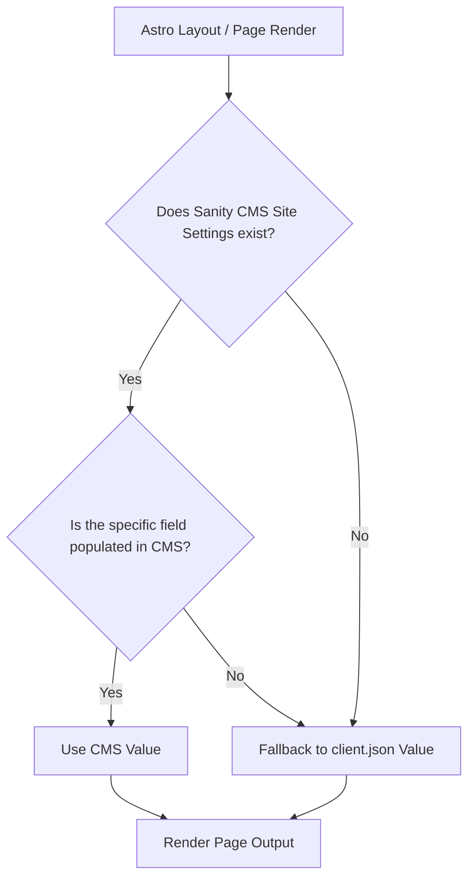

# ⚙️ Sanity CMS Dynamic Site Settings & Google Tools Integration Guide

This guide explains how the dynamic website configuration system works and provides detailed, step-by-step instructions on how to fetch and configure Google Analytics, Google Tag Manager, and Google Search Console.

---

## 🏛️ 1. System Architecture: CMS-First with Local Fallbacks

To ensure maximum flexibility and safety, the website uses a **CMS-First with Local Fallback** design pattern:



1. **Sanity CMS (`siteSettings` schema)**: The primary dashboard for clients or editors. When values are entered and published here, they take immediate effect on the production site without code deploys.
2. **Local Default config (`client.json`)**: Serves as the baseline developer fallback. If Sanity has not been initialized, or a specific field is blank, the frontend falls back to `client.json` to prevent crashes or blank titles.

---

## 🔎 2. Step-by-Step Google Tools Setup

Follow these exact steps to fetch the IDs required for Search Console, Analytics, and Tag Manager.

### Part A: Google Search Console (GSC) Verification ID
Google Search Console tracks organic keywords, site indexing status, and search visibility.
1. Go to [Google Search Console](https://search.google.com/search-console/) and sign in with a Google account.
2. Open the property selector in the top-left corner and click **Add property**.
3. Choose the **URL Prefix** method and input the client's URL (e.g., `https://clientbrand.com`). Click **Continue**.
4. In the verification popup, scroll down to **Other verification methods** and select **HTML Tag**.
5. GSC will show a meta tag:
   ```html
   <meta name="google-site-verification" content="XYZ123_random_string_here" />
   ```
6. Copy **only the content value** (e.g. `XYZ123_random_string_here`). This is your **Google Site Verification ID**. Do not close the Search Console tab yet.

---

### Part B: Google Analytics 4 (GA4) Measurement ID
GA4 tracks user traffic, session counts, user locations, and basic action logs.
1. Go to [Google Analytics](https://analytics.google.com/) and sign in.
2. Click the gear icon (**Admin**) in the bottom-left corner.
3. Click **Create Property**. Enter the property details (Name, Reporting Timezone, Currency).
4. Under "Choose a platform", select **Web**.
5. Input the Website URL (e.g., `clientbrand.com`) and Stream Name (e.g., `Main Web Stream`). Keep **Enhanced Measurement** enabled (it tracks scrolls, views, outbound clicks automatically).
6. Click **Create stream**.
7. In the Web Stream details page, look at the top right. Copy the **Measurement ID** (starts with `G-`, e.g., `G-12345ABCD`).

---

### Part C: Google Tag Manager (GTM) Container ID
GTM is the container that controls all pixel triggers, custom buttons, scroll trackers, and reporting tags.
1. Go to [Google Tag Manager](https://tagmanager.google.com/) and sign in.
2. Click **Create Account**. Enter an Account Name (e.g. `Agency Name`) and Country.
3. In Container Setup, enter the container name (e.g. `clientbrand.com`) and choose **Web** as the Target Platform. Click **Create** and agree to terms.
4. Close the pop-up showing the installation code. Look at the top menu bar next to the "Submit" and "Preview" buttons.
5. Copy your **GTM Container ID** (starts with `GTM-`, e.g., `GTM-W8XYZ12`).

---

### Part D: Page View Tracking on SPA Transitions
Since the website uses client-side routing (`<ClientRouter />` for smooth page transitions), standard analytics tags do not auto-fire on subsequent navigations because there is no full page reload.
The starter kit handles this automatically by hooking into Astro's `astro:page-load` event and pushing a `page_view` event to `window.dataLayer`:
- **Event Name**: `page_view`
- **Data Variables**: `page_path` and `page_title`

To configure this in GTM:
1. **Create Trigger**:
   - Go to **Triggers** -> **New**. Name it `Trigger - SPA Pageview`.
   - Trigger type: **Custom Event**.
   - Event name: `page_view`. Save.
2. **Create Variables**:
   - Go to **Variables** -> **New (User-Defined)**. Name it `dlv - page_path`.
     - Variable type: **Data Layer Variable**.
     - Data Layer Variable Name: `page_path`. Save.
   - Go to **Variables** -> **New**. Name it `dlv - page_title`.
     - Variable type: **Data Layer Variable**.
     - Data Layer Variable Name: `page_title`. Save.
3. **Create Tag**:
   - Go to **Tags** -> **New**. Name it `GA4 Event - SPA Pageview`.
   - Tag Configuration: **Google Analytics: GA4 Event**.
   - Measurement ID: Enter your GA4 ID `G-XXXXXXXXXX`.
   - Event Name: `page_view`.
   - Event Parameters:
     - Parameter Name: `page_location`, Value: `{{dlv - page_path}}`.
     - Parameter Name: `page_title`, Value: `{{dlv - page_title}}`.
   - Triggering: Select `Trigger - SPA Pageview`.
   - Save and publish.

---

## 🛠️ 3. How to Configure the IDs in Sanity Studio

Once you have gathered these IDs, you can configure them dynamically in the Sanity CMS:

### Step 1: Run your Local CMS
1. Open your terminal at the root workspace directory.
2. Start the development servers:
   ```bash
   pnpm dev
   ```
3. Open your browser and navigate to **Sanity Studio** at `http://localhost:3333`.

### Step 2: Open Site Settings
1. In the Studio left-side navigation sidebar, select **Site Settings** (this is a Singleton document).
2. You will see several structured groups/tabs:
   - **Business Information**: Enter Name, Legal Name, Tagline, Founded Year, and Company Logo.
   - **Contact Details**: Enter Email, Support Email, Phone number, and Physical Address.
   - **Social Links**: Paste links to Twitter/X, LinkedIn, and GitHub.
   - **SEO Defaults**: Enter Default Page Title, Default Description, and Default Share Image (fallback OpenGraph card).
   - **Analytics & Tracking**: Paste your Google tracking IDs:
     - **Google Site Verification ID**: `XYZ123_random_string_here` (from Part A)
     - **Google Analytics ID**: `G-12345ABCD` (from Part B)
     - **Google Tag Manager ID**: `GTM-W8XYZ12` (from Part C)

### Step 3: Publish Changes
1. Click the green **Publish** button at the bottom right.
2. The Astro frontend will immediately fetch these updated parameters.
3. Go back to your **Google Search Console** browser tab and click **Verify**. It will detect the newly published meta tag on the site and verify ownership immediately!

---

## 📈 4. Premium Tracking & Looker Studio Mappings

The starter kit tracks advanced interactions out-of-the-box and routes them directly to `window.dataLayer`. Here is how they are structured and mapped in Google Tag Manager (GTM) for premium Looker Studio reporting:

### 1. Form Submission Tracking (Lead Conversions)
- **DataLayer Event**: `form_submission`
- **Variables Pushed**: `form_id` (the element ID or name of the form), `page_path`
- **GTM Setup**:
  - **Trigger**: Custom Event named `form_submission`.
  - **Variables**: Data Layer Variable named `form_id`.
  - **GA4 Event Tag**: Event name `generate_lead` with parameter `form_id` -> `{{dlv - form_id}}`.
- **Looker Studio Benefit**: Allows you to report the exact conversion counts and which lead forms (Contact Form, Newsletter signups) captured the most users.

### 2. Outbound Link Tracking (Leakage & Affiliates)
- **DataLayer Event**: `outbound_click`
- **Variables Pushed**: `outbound_url` (the target destination link), `page_path`
- **GTM Setup**:
  - **Trigger**: Custom Event named `outbound_click`.
  - **Variables**: Data Layer Variable named `outbound_url`.
  - **GA4 Event Tag**: Event name `click_outbound` with parameter `url` -> `{{dlv - outbound_url}}`.
- **Looker Studio Benefit**: Report precisely where users go when they click links leading away from the client's site (social media handles, partner programs, external portals).

### 3. Real-User Core Web Vitals Tracking (UX & Speed Reports)
- **DataLayer Event**: `web_vital`
- **Variables Pushed**: `vital_name` (`LCP`, `CLS`, or `FID`), `vital_value` (numeric score/time in ms)
- **GTM Setup**:
  - **Trigger**: Custom Event named `web_vital`.
  - **Variables**: Data Layer Variables named `vital_name` and `vital_value`.
  - **GA4 Event Tag**: Event name `performance_metric` with parameters:
    - `metric_name` -> `{{dlv - vital_name}}`
    - `metric_value` -> `{{dlv - vital_value}}`
- **Looker Studio Benefit**: Build real-user performance speed cards (Average LCP, CLS scores) to prove that the Astro edge setup delivers a fast UX directly in the monthly client reports.

### 4. Scroll Depth Tracking (Content Consumption Reports)
- **DataLayer Event**: `scroll_depth`
- **Variables Pushed**: `scroll_percentage` (`25`, `50`, `75`, `100`), `page_path`
- **GTM Setup**:
  - **Trigger**: Custom Event named `scroll_depth`.
  - **Variables**: Data Layer Variable named `scroll_percentage`.
  - **GA4 Event Tag**: Event name `scroll` with parameter `percent` -> `{{dlv - scroll_percentage}}`.
- **Looker Studio Benefit**: Build content consumption heat maps to check how deep down users read the pages (e.g. if they scroll past 50% to see testimonials).

### 5. JavaScript Exception Tracking (Automated Quality Assurance)
- **DataLayer Event**: `js_error`
- **Variables Pushed**: `error_message`, `error_source` (filename:line), `page_path`
- **GTM Setup**:
  - **Trigger**: Custom Event named `js_error`.
  - **Variables**: Data Layer Variables named `error_message` and `error_source`.
  - **GA4 Event Tag**: Event name `exception` with parameters `message` -> `{{dlv - error_message}}` and `source` -> `{{dlv - error_source}}`.
- **Looker Studio Benefit**: Monitor runtime browser bugs dynamically, allowing developers to detect and patch browser-specific crashes before the client notices.

### 6. Text Copy Clipboard Tracker (High-Intent Action)
- **DataLayer Event**: `text_copy`
- **Variables Pushed**: `copied_text` (truncated to 60 characters for security/privacy), `page_path`
- **GTM Setup**:
  - **Trigger**: Custom Event named `text_copy`.
  - **Variables**: Data Layer Variable named `copied_text`.
  - **GA4 Event Tag**: Event name `copy_text` with parameter `text` -> `{{dlv - copied_text}}`.
- **Looker Studio Benefit**: Capture user actions copying contact emails, phone numbers, or addresses. This represents a very high intent interest!

---

## 📡 5. Verification Check: How to Confirm it Works

To confirm that the scripts are running correctly:
1. Open your website in the browser (e.g., `http://localhost:4321` in development).
2. Right-click anywhere on the page and select **View Page Source** (or press `Ctrl+U`).
3. Search (`Ctrl+F`) for your GTM ID or GA4 ID (e.g., `GTM-` or `G-`).
4. You should see the scripts rendered dynamically:
   - Inside `<head>`: The GTM loading script and the GA4 gtag script.
   - Inside `<body>` (right after opening tag): The GTM `<noscript>` fallback `<iframe>`.
5. Install the Chrome extension **Google Tag Assistant Legacy** or use the GTM **Preview Mode** to verify that clicks and pageviews trigger events on GTM container streams.
